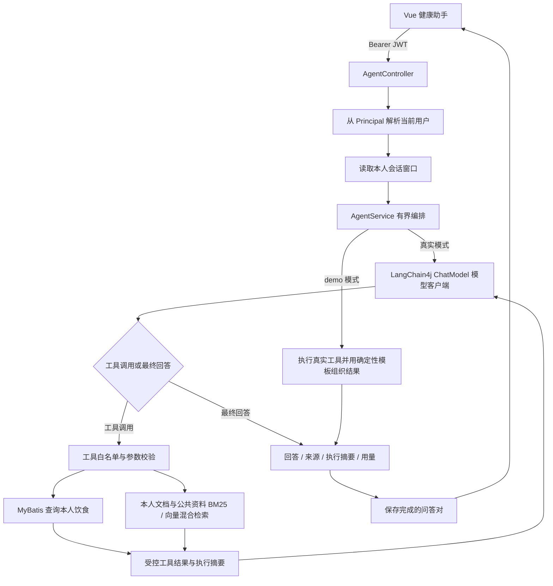

# NutriTrack Agent 架构与验收

## 能力范围

新增健康助手复用 Spring Boot、JWT 身份、MyBatis-Plus 和 MySQL 业务数据，使用 LangChain4j 的模型、消息和工具规格 API，通过结构化工具调用串联饮食查询、区间统计与营养知识检索。前端沿用 Vue 3，在原系统导航中增加健康助手入口。

这是单 Agent、只读工具、进程内短期会话的实现。关键词检索、模型调用和演示模式分别有明确边界；尚未实现向量数据库、长期记忆、SSE、多 Agent 或写入饮食记录的工具。

LangChain4j 使用普通 `langchain4j-open-ai` 依赖并由 Spring 显式注入，未使用 Spring Boot starter 或高层 AI Services 代理。框架负责模型协议转换和类型化数据；`AgentService` 仍掌控有界循环，`AgentMemory` 和 BM25 检索仍是本项目实现。迁移前后对照见 [LangChain4j 重构说明](LangChain4j重构说明.md)。

框架版本固定为 1.23.0，Spring Boot 保持 3.2.0；Jackson 通过 BOM 对齐至 2.22.4，移除了 `jackson-databind` 单独固定的 2.15.2 版本，避免框架与业务代码使用不一致的 Jackson 组件。

## 请求链路



一次 HTTP 请求完成后才返回结果与执行摘要，前端不展示完整模型内部推理。资料卡片是本轮检索命中的来源；显示链接不等于逐句事实校验，回答仍需结合资料和业务记录核对。

## 模块与工具

Agent 代码位于 `backend/src/main/java/com/myproject/agent/`，测试位于 `backend/src/test/java/com/myproject/agent/`。知识文段位于 `backend/src/main/resources/agent-knowledge.json`。核心职责是编排、模型协议、工具执行、检索和会话记忆；业务数据仍由既有 Mapper 读取。

`AgentService` 使用 `SystemMessage`、`UserMessage`、`AiMessage` 和 `ToolExecutionResultMessage` 组织上下文；模型提出的 `ToolExecutionRequest` 交由本项目工具白名单执行。`AgentTools.definitions()` 使用 `ToolSpecification` 和框架 JSON Schema 描述工具参数，真正执行时仍进行独立校验。模型返回的工具名称、参数或会话标识均不构成授权。

| 工具 | 参数 | 行为及边界 |
| --- | --- | --- |
| `get_meals` | `date`，ISO 日期 | 查询当前认证用户指定日期的饮食记录；返回已有数据，热量缺失时保持缺失 |
| `summarize_meals` | `startDate`、`endDate`，ISO 日期 | 汇总当前用户区间饮食，区间最多 31 天、记录最多 200 条；不能据此推断缺失天数的真实摄入量 |
| `search_knowledge` | `query`、`topK` | 从公共资料和本人文档中做BM25/本地中文向量/RRF混合检索，最多返回三条及文档、页码、文段、版本信息；不查询网络 |

查询用户身份不出现在工具参数中。模型不能选择任意用户、执行任意 SQL、访问文件或发起任意 URL 请求。

饮食记录里的 `calories` 是已记录的估算热量，缺失条目不能作为 0 kcal。`meal_records` 没有蛋白质、脂肪、碳水的原始克数；本次统计不能被解释为精确营养成分测量。

## HTTP 接口

以下接口需要登录，成功结果使用原项目的 `ResponseResult` 封装：`{code, message, data}`。

| 方法与路径 | 请求 | `data` 的主要内容 |
| --- | --- | --- |
| `GET /api/agent/status` | 无 | `mode`、`model`、`tools` |
| `POST /api/agent/chat` | `{message, sessionId?}` | `sessionId`、`answer`、`mode`、`steps`、`sources`、`usage` |
| `GET /api/agent/sessions/{sessionId}` | 本人会话 ID | `sessionId`、`messages: [{role, content}]` |
| `DELETE /api/agent/sessions/{sessionId}` | 本人会话 ID | 清除该会话记忆 |

`steps` 包含 `tool`、`arguments`、`status`、`durationMs`、`summary`；`sources` 包含 `id`、`title`、`url`、`excerpt`。`usage` 包含模型调用数、工具调用数、输入 / 输出 token 与总耗时：`modelCalls`、`toolCalls`、`promptTokens`、`completionTokens`、`durationMs`。token 统计取决于模型提供方是否返回用量，演示模式没有真实模型 token 消耗。

客户端不传 `userId`、`username` 或用于替代 JWT 的身份头。会话 ID 也不构成授权；读取、续聊及删除必须校验认证用户与会话所有者。

## 默认预算与记忆

配置前缀为 `nutritrack.agent`，以当前 `AgentConfig` 和 `application.yml` 为准。

| 配置 | 默认值 | 目的 |
| --- | --- | --- |
| `base-url` | `https://api.deepseek.com` | DeepSeek Chat Completions API 基址 |
| `model` | `deepseek-flash` | 当前 DeepSeek 工具调用示例模型，可按提供方调整 |
| `api-key` | 空 | 从环境注入，避免在仓库写入凭据 |
| `demo-enabled` | `true` | 未配置 API Key 时允许明确标注的演示模式 |
| `max-iterations` | `4` | 限制模型决策循环 |
| `max-tool-calls` | `8` | 限制一轮请求中执行的工具次数 |
| `request-timeout-seconds` | `20` | 单次模型 HTTP 调用超时 |
| `total-timeout-seconds` | `45` | 编排总执行时间预算 |
| `max-history-messages` | `12` | 保留最近最多六轮问答 |
| `session-ttl-minutes` | `60` | 会话过期淘汰 |
| `max-sessions` | `500` | 控制进程内会话数量 |

短期记忆只保留完成的用户 / 助手问答对，隔离不同用户。它不保存长期画像，不在进程间共享，服务重启后会丢失。多实例部署需引入共享存储及并发控制；这是后续工作。

时间预算约束不等于硬实时保证：还需结合数据库超时、连接池、运行时调度及部署环境观察实际耗时。演示模式执行确定性步骤，不能用于验证模型是否正确选择工具或理解连续追问。

LangChain4j 模型自动重试被关闭，避免一次业务调用在底层产生额外模型请求。HTTP 超时受单次请求上限和本轮剩余时间共同约束，保留完整响应读取的超时控制及响应体大小上限；框架异常不会直接作为含上游响应体的错误返回给用户。

## 本地启动与配置

先按仓库 README 初始化 MySQL、准备 Redis 与图片目录，然后在**启动后端的同一个终端**设置所需环境变量。`backend/.env.example` 是变量清单，Spring Boot 不会自动读取该文件；需要配置到终端环境或 IDE 启动配置。

```powershell
# 前端
Set-Location D:\Project\LLM\NutriTrack\frontend
npm install
npm run dev

# 另开终端启动后端；须已有 Java 21 与 Maven
Set-Location D:\Project\LLM\NutriTrack\backend
$env:DB_USERNAME = 'root'
$env:DB_PASSWORD = '<本机数据库密码>'
# Redis 如配置密码，设置 $env:REDIS_PASSWORD
# 留空使用明确标注的 demo 模式
$env:AGENT_API_KEY = ''
$env:AGENT_DEMO_ENABLED = 'true'
mvn spring-boot:run
```

无 Key 时确认页面显示演示模式。接入模型时设置 `AGENT_API_KEY`、`AGENT_BASE_URL` 和 `AGENT_MODEL`，使用提供方支持工具调用的模型与兼容基址，重启后端后确认状态显示真实模式。关闭演示且没有 Key 时应显示不可用。不要将 Key 放进前端代码或浏览器存储。

本次本机体验启动脚本读取 `D:/Project/LLM/.codex-work/run/local-config.json`。其中预留 `AGENT_API_KEY` 字段，并使用 `AGENT_BASE_URL=https://api.deepseek.com` 与 `AGENT_MODEL=deepseek-flash`。在本地填写 Key，保存后重启后端；非空 Key 优先进入真实模型模式，`AGENT_DEMO_ENABLED=true` 仅用于未填 Key 时继续体验。该 JSON 由体验脚本加载，直接通过 Maven 或 IDE 启动时仍应设置环境变量。Agent 通过 LangChain4j 的模型参数扩展对 DeepSeek 官方端点显式关闭 thinking，采用非思考工具调用流程；其他兼容端点不附带此扩展字段。

本机可用的 Java 21 路径是 `D:/Service/JDK21`；如果终端仍使用其他版本，可在启动前设置 `$env:JAVA_HOME = 'D:\Service\JDK21'` 并将其 `bin` 加入当前终端 `PATH`。部署时需设置稳定、私密、至少 64 个 ASCII 字符的 `JWT_SECRET`；开发环境未设置时使用进程级随机密钥，重启后旧登录 Token 会失效，需要重新登录。

本机体验脚本 `start-backend.ps1` 会在缺少 `JWT_SECRET` 时生成随机密钥并保存到仓库外的 `local-config.json`，后续启动复用，避免因重启导致签名变化。首次应用这个密钥时仍须重新登录一次。未登录、Token 过期或签名无效的受保护接口统一返回 HTTP 401，前端清除旧认证并提示重新登录；HTTP 403 保留为权限不足。

框架迁移后，`start-backend.ps1` 已改为 `java -jar D:/Project/LLM/NutriTrack/backend/target/backend-0.0.1-SNAPSHOT.jar`，`start-all.ps1` 也已同步更新产物检查与进程识别，不再使用旧 JAR 解包出的依赖。修改后端源码后，需重新打包再重启；配置仍使用同一份 `local-config.json`，页面地址仍为 `http://127.0.0.1:5173`。统一脚本会复用已有进程，重复执行并不等于重启后端。

## 验证命令

```powershell
Set-Location D:\Project\LLM\NutriTrack\backend
mvn '-Dtest=*Agent*Test' test

# 修改后端源码后，运行相关测试并重新生成可执行 JAR
mvn '-Dtest=*Agent*Test' package

Set-Location D:\Project\LLM\NutriTrack\frontend
npm run build
```

上述 Agent 测试通过 mock / 本地 HTTP 协议桩验证，不应访问真实模型或依赖生产数据库。原项目 `BackendApplicationTests.contextLoads` 会加载完整 Spring 上下文，运行全套测试前需要可用的数据库等依赖。构建通过只能证明代码可编译，不能代替下面的完整业务验收。

## 手工验收清单

准备账号 A、账号 B：A 有近七天记录，其中至少一条热量为空；B 有不同记录。记录日期必须落在测试问题的时间范围内。

| 场景 | 操作 | 验收标准 |
| --- | --- | --- |
| 未登录 | 无 Token 请求 `/api/agent/status` 和 `/api/agent/chat` | 被拒绝，不能使用模型或查询记录 |
| 本人记录 | A 询问“查看我今天吃了什么” | 真实模式按任务选择饮食工具；返回值与数据库相符，只包含 A 的记录 |
| 区间统计 | 询问最近七天记录与已记录热量 | 统计口径清楚，缺失热量 / 无记录日期不能解释为零摄入 |
| 营养资料 | 询问“如何减少盐的摄入” | 使用知识检索，来源卡片能打开；回答依据与命中文段一致 |
| 无数据 | 查询 A 没有记录的日期 | 明确说明无记录，不能编造菜品或健康评分 |
| 连续追问 | 真实模式先查一周，再问“只看其中昨天的记录” | 同一会话可使用保留的上下文；不将 demo 的固定模板当作此项通过 |
| 用户隔离 | B 使用 A 返回的会话 ID 读取、续聊、删除 | 全部拒绝，不返回 A 的历史文本 |
| 参数边界 | 让测试桩调用未知工具、非法日期、反向区间、超长区间、超大 `topK` | 返回受控错误，不越权、不扩大查询、不执行任意 SQL |
| 循环停止 | 测试模型持续返回工具调用 | 在配置预算内停止，不无限循环 |
| 上游失败 | 使用测试桩模拟超时、非成功状态、无效 JSON | 返回可理解错误，不能泄露凭据或将失败伪装成模型成功 |
| 清除会话 | 清除当前会话后新建对话 | 旧会话不能再读；新对话不携带旧健康文本 |
| 演示区分 | 不配置 API Key 后启动 | 页面和响应均标注 `demo`；仍使用真实业务查询和本地检索，无模型调用 |

工具执行摘要用于解释发生了什么，不要求输出模型内部思维链。手工验收时应同时记录 mode、关键工具及数据核对结果，避免仅凭界面截图判断功能通过。

## 验证记录

### 迁移前的历史验证

以下为截至 2026-11-01、引入 LangChain4j 之前的本机验证记录，不能作为 2026-11-03 框架迁移后的回归结论；单元与模拟接口验证也不能替代真实模型联调。

| 检查项 | 结果 |
| --- | --- |
| Agent 与 JWT 接口测试 | 33 项通过，0 失败、0 错误、0 跳过；包括实际 JWT 过滤器、会话读/续聊/删除隔离、旧接口伪造身份、本机 HTTP 模型协议桩、DeepSeek 请求格式及旧签名/过期 Token 返回 HTTP 401 |
| 后端完整编译 | Java 21 下 89 个主源码文件与 7 个测试源码文件编译通过 |
| 前端生产构建 | `npm run build` 通过；存在构建包体积提示 |
| 前端静态与浏览器检查 | 六个改动源文件 ESLint 通过；Chromium 模拟接口验证发送、工具摘要、来源链接协议、会话恢复/清除、错误处理及桌面/手机布局通过 |
| MySQL / Redis / 登录后的手工链路 | 本机体验实例已验证真实验证码、登录和饮食查询，体验账号查询到 11 条记录；保存本地签名密钥后，重启前签发的 Token 在重启后仍可访问饮食接口 |
| 真实模型工具调用 | 未运行；需配置有效密钥和支持工具调用的模型后，按上表验证 |

本机网络和 Maven 缓存有限，实际使用以下命令完成 33 项验证（较早的插件版本仅用于复用缓存，没有修改项目插件版本）：

```powershell
$env:JAVA_HOME = 'D:\Service\JDK21'
& 'D:\soft\IDEA\IntelliJ IDEA 2024.3\plugins\maven\lib\maven3\bin\mvn.cmd' `
  -s 'D:\Project\LLM\.codex-work\maven-settings.xml' -o -B `
  '-Dmaven-compiler-plugin.version=3.8.1' '-Dmaven-surefire-plugin.version=2.22.2' `
  '-DforkCount=0' '-Dtest=*Agent*Test' test
```

临时 Maven 缓存在项目仓库之外，仅服务本次验证；正常联网环境使用上文标准 Maven 命令即可。测试的 Mockito 使用 subclass mock maker 与 reflection member accessor，避免为了 mock 非 final 类而动态附加 Java agent。模型协议测试会监听本机临时端口，需要允许本机回环连接。

### LangChain4j 迁移后的本轮验证

2026-11-03 已重新执行相关回归，并完成当前 JAR 的打包和本机运行检查。本轮结果独立于上面的历史记录。

| 检查项 | 结果 |
| --- | --- |
| Agent 与 JWT 相关测试 | 40 项通过，0 失败、0 错误、0 跳过；覆盖 `AgentControllerTest`、`AgentMemoryTest`、`AgentToolsTest`、`AgentServiceTest`、`AgentModelClientTest`、`AgentFrameworkIntegrationTest` 和 `HealthAgentApiTest` |
| 真实框架本地集成 | `AgentFrameworkIntegrationTest` 两项使用真实 LangChain4j 组件和本地 HTTP 模型桩，验证工具执行结果回填与同一会话续聊，模型输出由测试桩控制 |
| 协议及安全边界 | 工具规格、调用 ID、用量累计、无 SDK 自动重试、原始协议异常工具字段拒绝、响应头后停滞超时和 1 MiB 响应体上限验证通过，原有身份及会话隔离测试通过 |
| 后端打包与启动 | `backend/target/backend-0.0.1-SNAPSHOT.jar` 构建成功，本机通过 `java -jar` 启动；仓库根目录旧 `nutritrack.jar` 未替换 |
| 本机业务链路 | 前端 HTTP 200；验证码、登录、Agent 状态及本人饮食查询均成功。状态返回 `mode=live`、`model=deepseek-flash`、`limits.framework=LangChain4j` |
| DeepSeek 线上端到端 | 本轮未发送真实模型聊天请求，尚未完成线上工具选择和回答效果验收 |

这些测试证明框架协议适配与受测业务边界通过，不能推导出线上模型回答准确率、并发能力或延迟收益。真实模型验收仍按手工清单执行。

## 后续迭代

- 增加由人工标注的固定问题集，分别评估工具选择、数据忠实性、资料相关性、无证据拒答及延迟，不将离线单元测试通过率当作模型回答准确率。
- 本地文档RAG、混合召回和初步对照评测已完成，见 [RAG架构与评测](RAG架构与评测.md)。后续根据更大语料与独立评测决定是否引入专用向量存储和重排。
- 多实例部署时引入共享会话存储、用户限流、持久化审计与更完整的监控，明确健康信息的保存和删除策略。
- 涉及个人健康目标写入或自动创建饮食记录时，单独设计写操作权限、校验和确认流程；本次工具均只读。

## 外部资料

知识库文段为人工整理的中文摘要，原始资料来自 WHO 的 [Healthy diet](https://www.who.int/news-room/fact-sheets/detail/healthy-diet) 与 [Sodium reduction](https://www.who.int/news-room/fact-sheets/detail/sodium-reduction)。它们用于一般营养信息，不代表系统具备诊断或个体营养处方能力。

模型协议可对照 DeepSeek 官方 [Tool Calls 指南](https://api-docs.deepseek.com/guides/tool_calls/) 和 [Create Chat Completion](https://api-docs.deepseek.com/api/create-chat-completion/) 检查。模型名称是否可用、是否支持该协议，需以实际账号与提供方为准。

框架实现可对照 LangChain4j 官方 [模型接口](https://docs.langchain4j.dev/tutorials/chat-and-language-models/) 与 [工具调用](https://docs.langchain4j.dev/tutorials/tools/) 文档。框架集成不等同于自动具备权限、可靠性或真实模型效果保证。

> 2026-11-04更新：文档RAG已实现并通过51项相关测试及真实DeepSeek样例链路验收。此前日期的测试和限制为历史记录；当前检索、存储及评测口径请以 [RAG架构与评测](RAG架构与评测.md) 为准。
