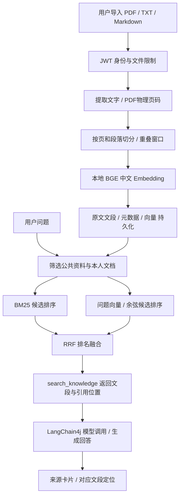

# NutriTrack 文档 RAG：实现、验收与面试说明

## 这次真正增加了什么

2026-11-04，将原来仅检索六条固定摘要的 `search_knowledge` 升级为文档知识库。支持文字版 PDF、UTF-8 TXT、Markdown 的导入、去重、更新、删除；采用真实的本地中文 Embedding、BM25、RRF 混合检索，并将文档、页码、文段和版本信息提供给健康 Agent。

现有 Spring Boot、LangChain4j、JWT、MyBatis、MySQL 及 Vue 保留。个人饮食记录仍通过只读数据库工具查询；个人上传文档由知识检索处理。Agent 的短期会话记忆仍在 Java 内存；知识文档及向量索引保存到磁盘，两者的生命周期不同。

## 运行和体验

启动方式仍是本机统一脚本：

```powershell
powershell -ExecutionPolicy Bypass -File "D:\Project\LLM\.codex-work\run\start-all.ps1"
```

登录后在工作台选择“营养知识库”，或访问 `http://127.0.0.1:5173/knowledge`。在 `agent_demo` 体验账号中已导入一份明确标注为功能样例的文档，可询问“我导入的文档中的检查口令是什么”，然后点击回答里的“查看对应文段”。样例源文件是 [文档导入示例](knowledge-examples/文档导入示例.md)，不是营养指南。

本机环境变化：原 `13306` 已由另一个项目的 Docker MySQL 占用，且其中没有 NutriTrack 数据库和应用账号。本次没有修改该容器，将原数据目录对应的项目 MySQL 改在 **13307** 启动，保留 `nutritrack_demo` 原数据与账号。后端连接配置已同步；Redis 复用已运行的 Docker `16379`，后端 `8080`、前端 `5173`。脚本能识别这个 Redis 容器并复用。

## 索引和查询两条链路



`RagDocumentParser` 负责提取内容；`RagChunker` 负责边界与位置；`LocalRagEmbedding` 负责本地模型；`RagRetrieval` 负责三种检索；`RagService` 负责权限、去重、版本、持久化；`RagController` 提供 HTTP 接口。`KnowledgeSearch` 是连接原 Agent 工具与新知识库的适配层。

## 主要技术选择

| 项目 | 当前实现与理由 |
| --- | --- |
| Embedding | LangChain4j 的 `BgeSmallZhV15QuantizedEmbeddingModel`，真实 512 维中文向量；使用 CPU，不需要另外填写向量 API Key |
| 模型推理 | ONNX Runtime，本机 Java 21 下验证固定 `1.20.0`；传递依赖 `1.23.2` 在本机初始化 DLL 失败。没有替换系统或 JDK 的 DLL |
| 文档切分 | 默认最多 450 个 UTF-16 字符、重叠 60 字符；优先换行边界，不跨 PDF 页；避免从代理项中间切开 Unicode 字符 |
| 文段上下文 | 保存标题、最近 Markdown 标题、页码、字符起点和文段 ID；向量输入附带截短的标题与章节，控制输入长度 |
| BM25 | 中文二元词项和拉丁词项；过滤部分问句停用词，默认要求至少 15% 查询词项覆盖，减少偶然公共词命中 |
| 向量查询 | 对权限筛选后的候选做精确余弦检索，默认最低相似度 0.55；这是需要用实际语料校准的阈值，不是正确率 |
| 混合检索 | 两路各取最多20个候选，按 `1/(60+rank)` 累加 RRF 分数，避免直接相加量纲不同的 BM25 与余弦分数 |
| 存储 | 单机 JSON 文档索引，保存已提取文字、元数据和真实向量；没有引入独立向量数据库，也没有实现 ANN 索引 |

目前知识量较小时，本地精确检索便于启动和调试。规模增大、多实例部署或复杂筛选需求出现时，应评估专用向量存储，并验证持久化、并发和过滤语义；不要在简历中写已使用 Milvus、Qdrant、Redis 向量索引或分布式检索。

## 文档管理、权限与一致性

- 身份从 Principal 映射为真实用户 ID，不接受请求中自报的 owner。内置公共资料只读；个人文档只对本人可见。
- 在 BM25 和向量检索之前筛选可见文档；文档读取、替换、删除都再次验证所有权，避免通过引用 ID 绕过权限。
- 同一用户相同文件 SHA-256 去重。不同用户相同文件分别建立各自记录，不能因去重返回他人的文档 ID。
- 文件更新先完成解析和向量计算，成功持久化后再发布新内存快照。失败时保留旧版本；并发更新通过版本复查拒绝覆盖。
- 用临时文件和原子移动发布完整 JSON。删除成功后从当前快照移除，服务重启从磁盘恢复。
- 索引保存模型标识和维度；不兼容的模型或损坏索引会报错，不会默默混用不同向量空间。更换 Embedding 模型需要重新索引。
- 引用含文档 ID、文段 ID、页码、版本。当前不保存旧版本全文；旧引用打开已更新的文档时会提示版本变化，删除后的引用返回不存在。
- 检索没有取得相关资料且没有个人饮食事实可用时，Agent 返回资料不足提示，不继续展示无来源的模型结论。引用 ID 检查不是逐句事实验证。

索引文件中存在用户原文，必须保持私有，不应提交 Git 或作为静态资源公开。当前只支持单进程索引写入；进程内快照和锁不构成跨进程一致性保证。

## 文件和容量边界

单文件最多10MB；PDF最多100页；提取文字最多7万字符；每文档最多160个文段，每人最多30篇和1000个文段，整个索引最多10000个文段；同时最多2个导入任务。解析和索引目前同步完成，页面显示进行状态。

首版支持有文字层的 PDF，不提供 OCR；不解析网页链接，不处理 Word 或扫描件。来源链接只是元数据，不会由服务器主动抓取。PDF页码为物理页序号；TXT、Markdown页码统一为1。前端显示提取出的原文文段，未保存或提供原PDF文件下载。

初始索引是 **8篇、10个文段**：6篇来自旧知识库的WHO简短摘要，以及2篇项目使用说明。它们用于起步，不代表完整营养知识库。实际浏览器验收又为体验账号导入1篇功能样例，总计9篇、11个文段。专业语料的扩充、审核和更新仍需要持续进行。

## 接口和配置

所有 `/api/knowledge/**` 接口需要登录，沿用 `{code,message,data}` 响应结构。

| 接口 | 用途 |
| --- | --- |
| `GET /api/knowledge/status` | 当前用户可见文档数、文段数、模型与存储信息 |
| `GET /api/knowledge/documents` | 公共与本人文档列表 |
| `POST /api/knowledge/documents` | multipart：file、可选title/sourceUrl |
| `GET /api/knowledge/documents/{id}` | 原文文段与定位元数据，不返回向量 |
| `PUT /api/knowledge/documents/{id}` | 用新文件替换并增加版本 |
| `DELETE /api/knowledge/documents/{id}` | 删除本人文档及当前索引 |
| `POST /api/knowledge/search` | `{query,mode,topK}`；mode为bm25/vector/hybrid，最多10条 |

Agent工具固定使用混合检索，最多3条；检索试验台允许对比三种方式。个人健康文本和检索文段作为数据处理，不是可改变系统规则的指令。

Spring Boot配置前缀为 `nutritrack.rag`。`RAG_DATA_DIR` 设置持久化目录；默认是后端工作目录下 `.nutritrack-rag`，已加入 Git 忽略。本机启动脚本在没有设置时使用 `D:/Project/LLM/.codex-work/run/rag-index`，DJL原生库缓存放在同级 `djl-cache`。聊天模型仍使用原来的 DeepSeek 配置。

## 2026-11-04 验收结果

| 检查 | 结果 |
| --- | --- |
| 相关自动化测试 | 51项通过，0失败、0错误、0跳过；包括原Agent、JWT、文档管理、跨用户访问、PDF解析、分块位置、持久化、真实向量及Agent引用链路 |
| 前端 | Vite构建与修改文件ESLint检查通过 |
| 浏览器实际业务 | 真实登录、页面导入、检索、原文定位、文档更新、旧引用版本提示、删除后404通过；手机宽度390px无横向溢出 |
| DeepSeek真实链路 | 页面提问后正确检索本人导入样例并回答检查口令，来源指向该文档；2次模型调用、1次工具调用，单次验收约2.7秒。不能将这个样例当作稳定延迟或通用效果结论 |
| 数据依赖 | 原体验库在13307运行且原账号可登录；复用16379 Redis，未改动其他项目Docker容器 |

隔离无头浏览器截图和HTTP验收记录位于本机 `.codex-work/run/rag-*.png`、`rag-smoke-result.json`、`rag-live-result.json`，未包含API Key或登录Token。示例对话只使用功能样例，没有进行个体营养处方或诊断评测。

## 检索诊断：真实数值与边界

`src/test/resources/rag-evaluation.json` 包含40个自编问题：32个有预期文档，8个库外问题。测试使用实际BGE模型和初始8篇、10个文段，不读取体验账号的个人索引。完整结果保存为 `target/rag-evaluation.json`，本轮快照为 [RAG评测结果.json](RAG评测结果.json)。

| 方式 | 有答案问题Top-3命中 | MRR@3 | 库外问题误召回 |
| --- | --- | --- | --- |
| BM25 | 24/32，75% | 0.75 | 0/8 |
| 向量 | 24/32，75% | 0.75 | 0/8 |
| 混合 | 28/32，87.5% | 0.875 | 0/8 |

命中表示前三个文段中包含预期文档；不代表文段足够支持完整回答。MRR未命中记0，命中按首个正确文档文段的倒数名次计分。两路能覆盖部分不同问题，本集混合比BM25高12.5个百分点，但仍有4个有答案问题没有召回。

这是开发者编写、包含调参样例的小型诊断集，不是独立测试集，也不是医学或回答准确率评估。阈值、文段长度和语料变化后必须重测；8个负例零误召回不能说明一般情况下不会误召回。测试顺序和模型预热影响耗时，报告中的均值不是严格性能基准。

复现（已有Java 21和Maven，首次需要下载依赖）：

```powershell
Set-Location D:\Project\LLM\NutriTrack\backend
$env:JAVA_HOME = 'D:\Service\JDK21'
mvn '-Dtest=*Agent*Test,*Rag*Test' test
mvn -DskipTests package
```

本机实际使用工作区Maven缓存及 `maven-compiler-plugin=3.8.1`、`maven-surefire-plugin=2.22.2`、`forkCount=0` 运行上述测试。没有运行依赖原默认数据库配置的全量Spring上下文测试。

## 面试时如何讲

> 我把健康助手原来的固定摘要检索升级为文档RAG，支持PDF、TXT、Markdown解析与分块，用本地中文BGE模型生成512维向量，结合BM25和RRF做混合检索。用户身份在检索前过滤，文档支持去重、持久化、版本更新和删除，回答可以定位到来源文段。我还做了小型检索诊断集，对比单路和混合检索，并记录了未命中用例。

应能解释：为什么采用字符窗口与重叠、如何保留页码、为什么用排名融合、为什么设置阈值、如何防止跨用户召回、模型换维度怎么重建索引、旧引用更新后怎么办，以及小样本评测能说明什么。

后续优先补充经过审核的营养资料、独立人工标注问题集和回答忠实性评测，再根据语料和延迟证据决定是否增加重排或独立向量存储。

框架参考：[LangChain4j RAG](https://docs.langchain4j.dev/tutorials/rag/)、[本地ONNX Embedding](https://docs.langchain4j.dev/integrations/embedding-models/in-process/)。
